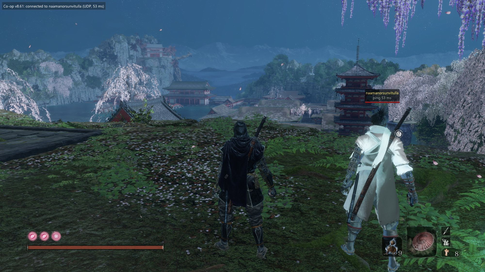
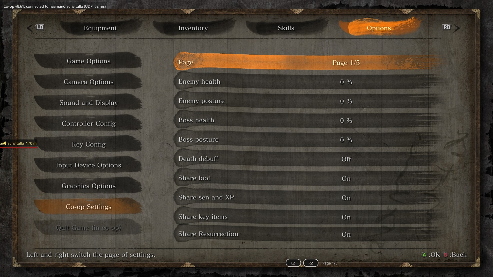
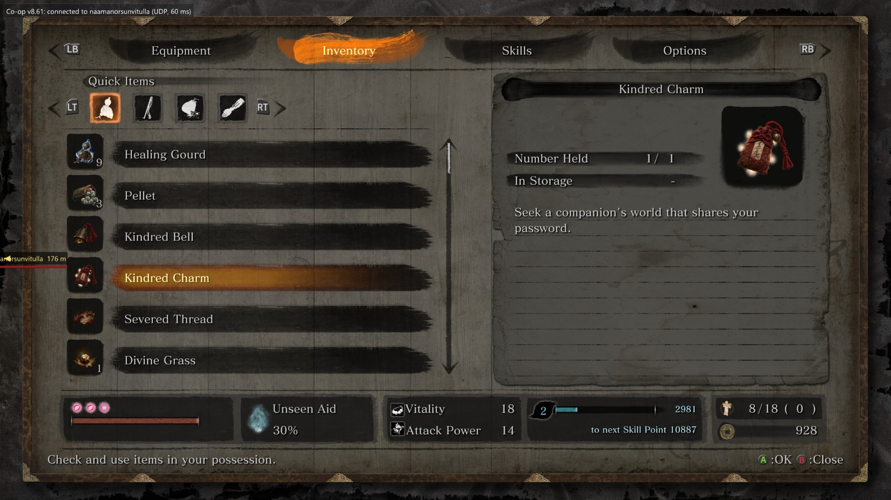

# Sekiro Seamless Co-op

Seamless co-op mod for **Sekiro: Shadows Die Twice**. Kinda like the Elden Ring Seamless Co-op mod but for Sekiro. You and your friends (2-6 players) play in the same world, fight the same enemies and bosses, and the session doesn't die when someone dies, warps or hits a loading screen.



**Download:** [Nexus Mods](https://www.nexusmods.com/sekiro/mods/2944) or [GitHub Releases](https://github.com/Tihvert/sekiro-coop/releases).

## Heads up, read this first

**The mod is still buggy.** It's a beta. Me and my buddy played a lot with it and most stuff works, but there's plenty of jank left (list below). Back up your saves.

I already beat the game so my motivation to keep building this dropped a lot. I might still come back to it at some point, no promises. That's why it's open source now: if you want to keep going with it, fork it, fix stuff, send PRs, make your own version, whatever. Everything I have that's useful for debugging is in here too (see [For devs](#for-devs)).

Also, full honesty: this was made with a LOT of help from AI (mostly Claude). I can read code a bit but I didn't write most of this by hand. My part was the idea, testing it in game over and over, reading logs and telling the AI what's broken. So if some code looks weird, that's why.



## What works

- 2-6 players, one host and everyone else joins the host. 2 players is tested a lot, 3+ only in unit tests, never live.
- Other players show up as real player characters with name, ping and their gear.
- Enemies and bosses synced (the mod runs the game's own online netcode over its own connection).
- Bosses, idols, shortcuts and NPC quest progress synced.
- Boss rules: if you die in a boss fight you wait or spectate until the boss dies or everyone's dead. Spectate camera can switch between alive players.
- Resting respawns enemies for everyone.
- XP, sen, drops, boss rewards and key items shared (can be turned off).
- Enemy and boss scaling for co-op, optional death debuff.
- Deathblow lock so two people can't deathblow the same enemy.
- Party HP bars.
- Co-op uses its own save file, your normal save isn't touched. Auto backups every 10 min.
- Co-op Settings page inside the game's own Options menu.

## What's broken / not done

- Resurrect sometimes isn't offered when it should be. There's a fix in, but it's not tested in game yet.
- Spectate sometimes goes to a black screen.
- Enemies or bosses can desync between players now and then.
- Lag / stutter spikes, mostly on the host.
- Puppeteer Ninjutsu puppets used to die instantly. There's a fix, not tested in game yet.
- 3-6 players never tested live.
- Some flags can get lost, so the own world restore after co-op can miss some story/NPC stuff.
- Levers, lifts and breakables aren't synced. Doors are, sort of.
- Story phases (ministry invasion, burning castle, Shura) aren't handled as their own thing.
- Dragonrot, Bell Demon, Kuro's Charm and cutscenes aren't handled specially.
- The game can crash. Not often but it happens.
- The last batch of fixes before 1.0 beta hasn't been tested in game, I stopped playing around there.

## How to install

You need:

- Sekiro on **Steam, version 1.06** (the last patch, normal unmodded exe)
- [me3 mod loader](https://github.com/garyttierney/me3/releases) (Windows installer, default options are fine)
- Windows

Steps:

1. Install me3.
2. If you have Sekiro Online or other online mods, remove them first. Delete `dinput8.dll`, `steam_api64.org`, `cream_api.ini` and `SekiroOnlineFont.ttf` from the game folder, then in Steam do Properties > Installed Files > Verify integrity.
3. Unzip the mod into any folder. **Not** the game folder.
4. Start Steam, run `play.cmd` once, then close the game. The mod makes `sekiro_coop_settings.ini` next to the DLL.
5. Open the ini and put the **same password** for everyone (`password = ...`). Co-op stays off while it's empty.
6. Everyone needs the exact same mod version.

## How to play

1. Start the game with `play.cmd` and load your save.
2. After the intro (you lose to Genichiro and wake up at Dilapidated Temple), rest at the temple idol. You get 3 items:
   - **Kindred Bell**: open your world (host)
   - **Kindred Charm**: find the host's world and join it
   - **Severed Thread**: leave co-op
3. Host uses the Bell, everyone else uses the Charm. The top left corner shows connection status.
4. To stop, use the Severed Thread or just quit to the title screen.



### Connecting

- Default is Steam, and if that doesn't connect in 15 s it switches to direct UDP.
- Direct UDP: the host needs port **28100 UDP** open or forwarded (the mod tries UPnP). The host's address gets written to `udp_join_code.txt`. Joiners put it in `udp_host_address` and set `transport = udp`.
- The password only gets sent as a hash.

### Settings

Either edit `sekiro_coop_settings.ini` (it gets re-read every couple seconds) or use Options > **Co-op Settings** in game. The host's game rules (scaling, debuffs, sharing) apply to everyone. Every setting has a comment in the ini.

### Saves

Co-op uses `S0000.coop.sl2`, copied from your normal save the first time. Your normal `S0000.sl2` isn't touched. Backups go to `%LOCALAPPDATA%\sekiro-coop\save-backups\` (10 newest kept). Still, make your own backup before playing.

## When something breaks

- The log is at `%LOCALAPPDATA%\sekiro-coop\log.txt`.
- Press **F11** (or Back/Share on a controller) right when a bug happens. That puts a marker with the time in the log and dumps a bunch of extra state, so it's way easier to find later.
- Open an issue on GitHub with what happened, around what time, and both players' logs if you can.

## For devs

All the source and pretty much all my debug stuff is here. Most of the notes in `docs/` are in Finnish because that's what I worked in, sorry. Any translator handles them fine.

| Where | What |
|---|---|
| `crates/coop-dll` | the mod itself (hooks, sync, boss rules, UI, settings) |
| `crates/coop-net` | network layer (UDP, password join, reliable messages, UPnP), unit tested |
| `crates/coop-audit` | log analyzer: compares the host's and friends' logs and finds desyncs |
| `vendor/sekiro` | vendored `sekiro` crate from fromsoftware-rs with a small fix (own license, see below) |
| `docs/` | everything: research, reverse engineering notes, bug hunts, specs, test notes |
| `docs/JATKA-TASTA-MULTIPLAYER.md` | the dev log, newest on top, every version and every bug with log analysis. Start here |
| `docs/IMPLEMENTATION-NOTES.md` | how each system works and why |
| `docs/RE-*.md` | reverse engineering findings (offsets, structs, game functions) |
| `re/` | the IDA and memory scan scripts I used + summary lists of what they found |
| `tools/icons/` | how the custom item icons get made and injected |
| `ship/` | the tester launcher scripts (auto update, log upload, Finnish guide) |
| `serve.ps1`, `test-server.cmd` | the little tester server: friends' logs and saves get uploaded to the host and run through coop-audit |

Building: Windows, Rust stable (`rust-toolchain.toml`), VS 2022 Build Tools with C++ and a Windows SDK.

```bat
build-dist.cmd   rem release build into target-dist\
test.cmd         rem unit tests for coop-net and coop-audit (no game needed)
release.cmd      rem build + tester package into dist\
```

The `.cmd` files assume the default VS 2022 Build Tools path, edit them if yours is somewhere else.

**Not included on purpose:** the decompiled game code from IDA (that's FromSoftware's code, can't share it) and the game's archive keys `tools/icons/build_icons.py` needs. The keys are in UXM / BinderTool if you need to rebuild the icons. The docs and `re/` summaries still have all the addresses and findings, so you can redo any of it with your own copy of the game.

## Credits

- **naamanorsunvitulla**. My co-op buddy, played through all of it with me, tested every broken build and sent a ton of logs. This wouldn't exist without them.
- [fromsoftware-rs](https://github.com/vswarte/eldenring-rs) by vswarte, the `sekiro` crate in `vendor/sekiro`.
- [me3](https://github.com/garyttierney/me3) by Gary Tierney and contributors, the mod loader.
- [hudhook](https://github.com/veeenu/hudhook) by veeenu, for the in-game overlay.
- Elden Ring Seamless Co-op by LukeYui and the DS3 seamless mods, the inspiration.
- Built with a lot of help from Claude (Anthropic).

## Support

If you like it and want to throw a coffee my way: [ko-fi.com/tihvert](https://ko-fi.com/tihvert) (card, PayPal, Apple/Google Pay). Totally optional.

Crypto works too:

- **BTC:** `bc1qlytmy276zcsqw8dw2u43ywh7nuaf7qhufjrrh3`
- **LTC:** `LNgsoAL6tZr7NJBTshy15ucCzE65r6uWHp` (cheapest for small amounts, fees are basically nothing)

## Changelog

- **1.0 beta** (2026-10-28): first public release. Internally this is build 8.62; the dev log in `docs/JATKA-TASTA-MULTIPLAYER.md` uses those 8.x numbers.

## License

My code is MIT, see [LICENSE](LICENSE). `vendor/sekiro` keeps its own license (MIT NON-AI OR Apache NON-AI, files in that folder), which among other things means that code can't be used in AI training datasets.

Unofficial fan mod. Not affiliated with FromSoftware, Activision or Valve. It doesn't touch the official online mode. Use at your own risk and back up your saves.
